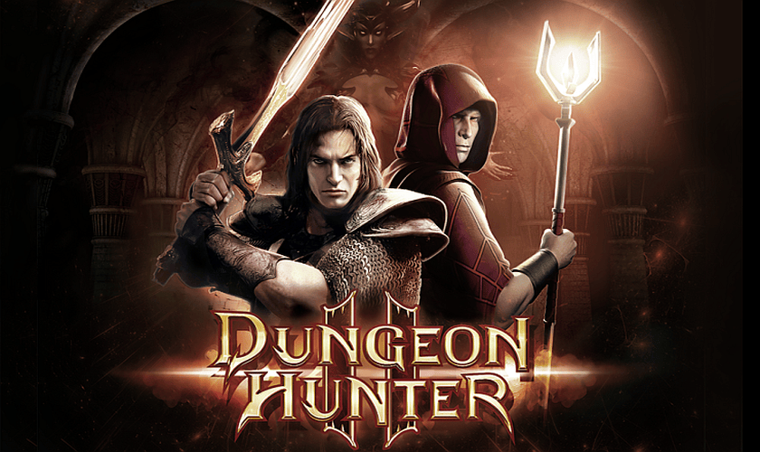

<h1 align="center">
  <br>
  Dungeon Hunter 2 · PS Vita Port
</h1>

<p align="center">
  <b>Native port of Dungeon Hunter 2 HD (Gameloft) for PlayStation Vita and PlayStation TV.</b>
</p>

<p align="center">
  
  
  
  
  
  
</p>

<p align="center">
  <a href="#-description">Description</a> •
  <a href="#-features">Features</a> •
  <a href="#-controls">Controls</a> •
  <a href="#-installation">Installation</a> •
  <a href="#-known-issues">Known Issues</a> •
  <a href="#-building-from-source">Build</a> •
  <a href="#-credits">Credits</a>
</p>

---

## 📖 Description

A native port of Gameloft's **Dungeon Hunter 2 HD** (Android, APK v1.0.2) to the PlayStation Vita, built on
the so-loader technique of [TheFloW](https://github.com/TheOfficialFloW): the original Android `.so` libraries are
relocated and run directly on the Vita. A from-scratch [FalsoJNI](https://github.com/v-atamanenko/FalsoJNI)-based
bridge stands in for the parts of the Android runtime the game calls into (rendering surface, touch input, asset
loading, audio), and rendering goes through [vitaGL](https://github.com/Rinnegatamante/vitaGL) built from source.

**This repo is loader/bridge source code only.** It does not contain, and will never contain, Gameloft's copyrighted
game assets, APK, or `.so` binaries. See [Getting the game data](#getting-the-game-data) for what you need to supply.

---

## 🎮 Status & Playability

**Status: Playable (beta), with known bugs. Help wanted.**

The game boots, renders, and is playable start to finish on real hardware: menu, character select, dungeon
combat, saves and options that persist across reboots, and physical-button controls (movement, attack, skills,
potion, pause and character menus). It is **not polished**. The open issues below could use more eyes, more test
hardware and fresh ideas. None of them block booting or playing. Issues and PRs are welcome.

- [x] **Boot and first frame**: first frame renders on real hardware (`PORTING_PLAN.md`, Phase 2; `log_057.txt`).
- [x] **Physical controls**: movement, attack, skills, potion, pause and character menu. *Verified on console.*
- [x] **Saves and options**: persist across reboots (`RELEASE_NOTES.md`, v1.1.0). *Verified on console.*
- [ ] **Combat frame rate**: about 20–25 FPS in gameplay, about 60 FPS in menus and light scenes. See Known Issues.
- [ ] **Two rendering bugs**: repeating HUD icon column and some invisible enemies (see Known Issues).

The release notes for each version are in [`RELEASE_NOTES.md`](RELEASE_NOTES.md) (current: v1.1.0 "Physical
Controls & Persistence"). Full paper trail of every hypothesis and diagnostic: [`PORTING_PLAN.md`](PORTING_PLAN.md).

---

## ✨ Features

| Feature | Status | Notes |
| :--- | :---: | :--- |
| Boots to gameplay | ✅ | Menu, character select and dungeon combat run on hardware. |
| Graphics / renderer | 🟡 | vitaGL. About 20–25 FPS in combat, about 60 FPS in menus; repeating HUD icon column and invisible enemies still open. |
| Audio & music | ❔ <!-- TODO --> | Not documented in the README; confirm on console. |
| Video / cutscenes | ❔ <!-- TODO --> | Not documented in the README; confirm on console. |
| Physical buttons | ✅ | Cross, Square, Triangle, Circle, R1, Start, Select, L+R. |
| Analog sticks / camera | ✅ | Left stick / D-Pad moves. |
| Touch screen | ✅ | Touch drives the same actions as the buttons. |
| Button remapping / port menu | ❌ | Not implemented. |
| Save data | ✅ | Saves and options persist across reboots. |
| Native trophies | ❌ | Not documented in this repo. |
| Languages | ❔ <!-- TODO --> | Not documented in the README. |
| Performance | 🟡 | About 20–25 FPS sustained in gameplay (up from 5–6 at first). |
| Online / IAP / ads | ➖ | Not documented in the README. |
| PS TV | 🧪 | Same VPK; not tested on PS TV. |

Legend: `✅ Working (verified on console) · 🧪 Implemented, not yet verified on console · 🟡 Partial · ❌ Not working · ➖ Not applicable · ❔ Not documented yet`

---

## 🎯 Controls

| Input | Action |
|---|---|
| Left stick / D-Pad | Move |
| Cross | Primary attack |
| Square | Skill 1 |
| Triangle | Skill 2 |
| Circle | Skill 3 |
| R1 | Health potion |
| START | Pause / in-game menu (toggle) |
| SELECT | Character screen (toggle) |
| L + R | Toggle bottom HUD controls' opacity between 1% (default) and 100%, for touch |
| Touch | Everything above, plus anything else the HUD exposes |

The action buttons call directly into the engine's own command API (the same calls its Flash HUD buttons make)
rather than synthesizing touch events, after synthetic touch turned out to have a hard ceiling. See
`PORTING_PLAN.md` for why.

---

## 📋 Prerequisites

1. A PS Vita or PS TV running Custom Firmware.
2. [**kubridge**](https://github.com/TheOfficialFloW/kubridge) installed as a kernel plugin, from `vdpm` for the build
   and `ur0:tai/config.txt` for the console.
3. Sony's `libshacccg.suprx` (shader compiler), obtained separately and placed in `ur0:data/`. It is Sony's own binary
   and is not redistributed here.
4. A legally owned copy of **Dungeon Hunter 2 HD** for Android (see [Getting the game data](#getting-the-game-data)).

---

## 📦 Installation

1. Install the VPK with **VitaShell**.
2. Stage the game's asset files as loose files under `ux0:data/dungeon-hunter-2/` (see `PORTING_PLAN.md`, Phase 8,
   for the layout FalsoJNI's asset bridge expects).
3. Launch the game from the LiveArea.

### Getting the game data

You need to legally own **Dungeon Hunter 2 HD** for Android to play this port. This repo does not include the APK,
its extracted contents, or any decompiled output. `.gitignore` excludes all of it by design (see `PORTING_PLAN.md`,
§3). To build a playable install:

1. Obtain the APK from your own legally purchased copy.
2. Decompile it if you need to cross-reference the original code (`porting_tools/build/decompile_all.sh` wraps
   `jadx` and a Ghidra/angr container). This is not required just to play. <!-- TODO: `porting_tools/` is not in this checkout. -->
3. Stage the game's asset files as loose files under `ux0:data/dungeon-hunter-2/` on the Vita.

---

## 🐛 Known Issues

1. **Low combat frame rate.** About 20–25 FPS sustained in gameplay (up from an initial 5–6), about 60 FPS in
   menus and light scenes. The engine's real frustum culling has to stay bypassed (it is what fixes the invisible-enemy
   bug below), so the whole level is updated every frame regardless of the camera. See `PORTING_PLAN.md`, Phase 23.
2. **Repeating HUD icon column.** A column of duplicate badge/skill icons appears stacked under the character portrait.
   The root cause is not found yet. Several native and ActionScript-level hypotheses are ruled out (see `PORTING_PLAN.md`).
3. **Some enemies render invisible.** A health bar, nameplate and aggro ring appear, but no monster model is drawn. The
   opacity hypothesis is ruled out. The current lead is a stale bounding box in the engine's own culling gate, found
   through full disassembly, not yet tested on hardware.
4. **Logs and crash dumps.** Crash dumps (`*.psp2dmp`) and their analysis are kept in `crash_dump/`. Runtime logs
   come from the console (`log_NNN.txt`).

---

## 🔨 Building from Source

Requirements:

- [VitaSDK](https://vitasdk.org/) (`arm-vita-eabi-gcc` / `g++`), with `kubridge` installed via `vdpm`. `vitaGL` is vendored
  in this repo and built from source, not the prebuilt `vdpm` package (see `VITAGL.md`).
- Sony's `libshacccg.suprx`, placed in the repo root (not redistributed here).
- `libshacccg.suprx` and the `kubridge.skprx` taiHEN plugin installed on the target Vita or Vita3K under `ur0:` / `ux0:tai`
  before the first run.

```bash
./build.sh
```

`build.sh` rsyncs the project to a space-free temp directory (VitaSDK's toolchain does not handle paths with spaces well),
configures with CMake, and copies the resulting `.vpk` / `eboot.bin` back into `build/`. It asks for a Debug (verbose
logging, `DEBUG_SOLOADER`) or Release build. See its header comment for the variants, including `--hack-safe`
(recommended: vitaGL's CPU-only speedhacks) and `--culling-test [MODE]` (experimental frustum-culling levels).

`porting_tools/manage_vita.py` installs to a real Vita or Vita3K over FTP, pulls logs, and downloads and symbolizes
crash dumps. See `porting_tools/README.md`. <!-- TODO: `porting_tools/` is not in this checkout. -->

The VPK name is `dungeon_hunter_2` (`VITA_VPKNAME` in `CMakeLists.txt`), Title ID `PSVDH0002`, version `01.00`.

---

## 📁 Project Structure

- `source/`: loader and bridge (soloader, FalsoJNI, input, rendering).
- `assets/`, `lib/`, `module/`: game-independent helpers and auxiliary libraries <!-- TODO: confirm contents -->.
- `sce_sys/`: LiveArea assets (`sce_sys/livearea/contents/bg0.png` is the banner).
- `vendor/`: vendored vitaGL (`VITAGL.md`).
- `PORTING_PLAN.md`: living plan: engine findings, phases, hypotheses and diagnostics.
- `PLAN_VITAGL_ALTERNATIVA.md`, `AI_WORKFLOW.md`: working notes.
- `RELEASE_NOTES.md`: release text for each version.
- `Docs/`: additional documentation.

---

## 📜 Disclaimer

**Dungeon Hunter 2** is © Gameloft. This project is an unofficial, non-commercial fan port and is not affiliated with or
endorsed by Gameloft. The repository contains no game assets, APK, `.so` binaries, or decompiled output.

---

## ☕ Support My Work

This project is **free** and will stay free. If you enjoy it, a tip from **$1** helps me keep porting games to the PS Vita:

<p align="center">
  <a href="https://ko-fi.com/metalsyntax"></a>
</p>

- **Ko-fi:** [ko-fi.com/metalsyntax](https://ko-fi.com/metalsyntax)
- **PayPal:** [paypal.me/MetalSyntax](https://paypal.me/MetalSyntax)
- **Bitcoin (BTC):** `133HdCsaWxdjTfmwpgGVykByhNBV338uRc`

**Ko-fi supporters get:**
- **Early access** to new ports before their public release (test builds of upcoming projects).
- **Data preparation scripts and step-by-step guides** to set up your own game files for each new port.
- A say in which games I port next.

> Game files are never distributed. You always need your own legally obtained copy of the game.

---

## 👥 Credits

- [SoLoBoP](https://github.com/v-atamanenko) (Andy Nguyen, Rinnegatamante, Volodymyr Atamanenko): the so-loader boilerplate this project is built on.
- [FalsoJNI](https://github.com/v-atamanenko/FalsoJNI): the JNI bridge implementation.
- [vitaGL](https://github.com/Rinnegatamante/vitaGL) by Rinnegatamante: the GLES driver, built from source.
- **Asphalt-5-Vita**: the closest comparable port (same soloader/FalsoJNI/vitaGL-from-source, Gameloft engine). Its
  performance write-up pointed at several of the CPU-side fixes that took this port from 5–6 FPS to about 20–25.
- **Gameloft**: original developer of Dungeon Hunter 2 HD.
- The PS Vita homebrew and porting community.

---

## 📄 License

The loader/bridge source code in this repository is MIT licensed. See [LICENSE](LICENSE). The license covers this
project's own code only, not Dungeon Hunter 2 itself.
